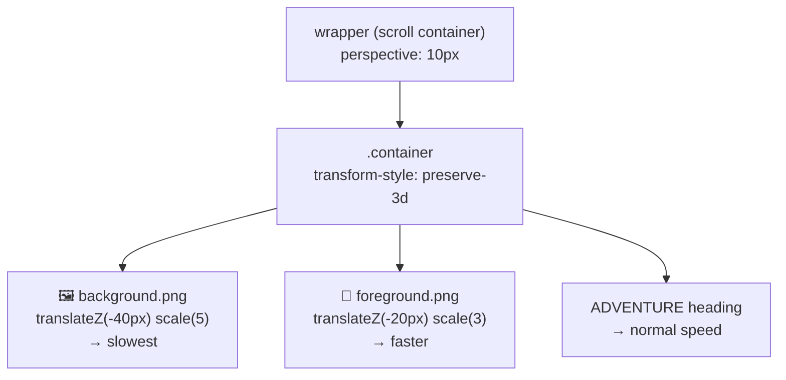

<div align="center">

# 🏔️ Parallax Website

**An "ADVENTURE"-themed landing page with a layered parallax hero — the background and foreground scroll at different speeds to create depth.**

[](https://parallax-effect-nine.vercel.app)


[How it works](#-how-the-effect-works) · [Sections](#-sections) · [Getting Started](#-getting-started)

</div>

---

## ✨ What's inside

A simple static website-cum-webpage built to practise one of the most eye-catching scroll effects on the web — **parallax**.

## 🎢 How the effect works

It's **pure CSS** — no JavaScript. The scroll container gets a 3D `perspective`, and each hero layer is pushed back along the Z-axis. Layers that are farther away scroll more slowly, which creates the depth illusion.



<details>
<summary><b>🔍 The key CSS</b></summary>

```css
#wrapper    { perspective: 10px; }
.container  { transform-style: preserve-3d; }
.background { transform: translateZ(-40px) scale(5); }
.foreground { transform: translateZ(-20px) scale(3); }
.bg         { background-attachment: fixed; }   /* section banners */
```

`scale()` compensates for the shrink caused by pushing a layer back, so each image still fills the screen.

</details>

## 🧭 Sections

| Section | Content |
|---|---|
| 🏔️ Hero | Layered parallax scene with the **ADVENTURE** title |
| 📺 Adventure Time | Text section about the show |
| 🚴 Biking | Fixed-background image banner + text |
| 🪂 Para Gliding | Fixed-background image banner + text |
| 🏄 Surfing | Fixed-background image banner + text |

## 🚀 Getting Started

```bash
git clone https://github.com/Shariq2003/Parallax-Website.git
cd Parallax-Website
# open index.html in your browser
```

<details>
<summary><b>📁 Project structure</b></summary>

```text
Parallax-Website/
├── index.html
├── index.css
├── background.png   # far layer
├── foreground.png   # near layer
└── *.jpg            # section banners
```

</details>

---

<div align="center">

Built by **[Shariq](https://github.com/Shariq2003)** · [LinkedIn](https://www.linkedin.com/in/shariq-sd)

⭐ If you like this project, consider giving it a star!

</div>
